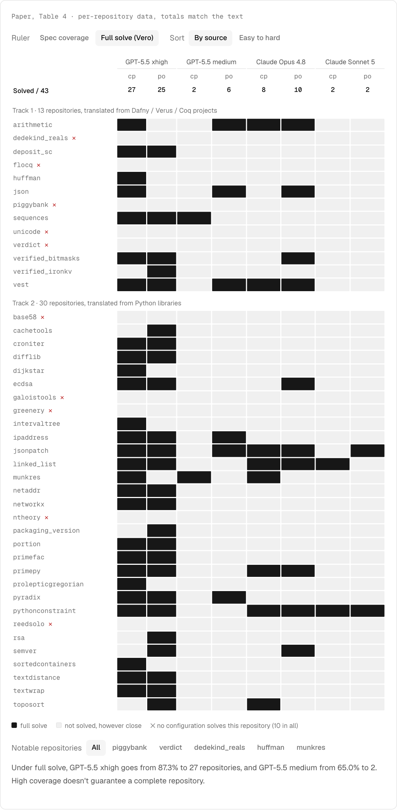

# Vero: Can AI Agents Build Formally Verified Software Repositories?

<p>
  <a href="./README.md"></a>
  <a href="./README.zh-CN.md"></a>
</p>

Ye et al. · 2026 · [arXiv:2608.13522](https://arxiv.org/abs/2608.13522) · [GitHub](https://github.com/sunblaze-ucb/vero)

Earlier verified code generation benchmarks test single functions, or give the agent an implementation and ask only for proofs. Vero asks for both, across a whole repository.



## Abstract

> AI agents are increasingly used for programming, but do not provide any guarantee on the correctness of generated code. Verified code generation, in which an agent produces both an implementation and a machine-checked proof of its specification, offers a stronger path toward trustworthy AI-generated software. Existing benchmarks in this direction either focus on individual functions or only evaluate proof generation with provided implementations. It is still an open question whether agents can make coherent implementation and proof choices across real multi-module codebases. To bridge this gap, we introduce Vero, the first benchmark to evaluate joint implementation and proof synthesis at the repository level. Vero contains 43 multi-module instances sourced from real-world repositories spanning Python, Dafny, Verus, and Coq, and covering diverse domains from cryptographic protocols to distributed systems. Each instance consists of a multi-module Lean 4 repository with predetermined API interfaces, manually curated formal specifications, and reference implementations, supporting both proof-only and code-and-proof evaluation modes. To improve benchmark reliability, Vero also includes an audit mechanism where agents are allowed to formally prove unsatisfiability of provided specification or incorrectness of reference code, which surfaces and corrects latent code and specification errors during curation. We evaluate frontier coding-agent configurations with Lean toolchain access. The strongest agent fully solves only 27 of 43 instances and closes no specifications on the hardest repositories. Vero provides a concrete testbed for measuring progress toward repository-scale verified software synthesis, where current agents still fall short. We release the benchmark, curation pipeline, and evaluation harness at https://github.com/sunblaze-ucb/vero.

## What changed

| | Before | After |
|---|---|---|
| **What gets tested** | Single functions, or proofs only against a given implementation | 43 multi-module Lean 4 repositories, 743 APIs, 2,705 specifications; code and proofs written together |
| **What counts as solved** | Coverage: the strongest configuration reaches 87.3% | Full solve: the strongest configuration reaches 27/43, and 10 repositories resist every configuration |
| **Cheating** | Lean accepts `sorry` and user-declared axioms, so compiling doesn't mean proved | A three-layer grader: marked regions, an axiom allowlist, declaration screening |
| **Implementation** | A fixed input | Open: the agent can pick an easier-to-prove algorithm, or break the build and score 0 |
| **Wrong specifications** | Count as agent failures | Agents can submit machine-checked negative evidence; 38 defects were found and fixed |

## In the paper's words

**What gets tested (Section 3.2)**

> Existing repository-scale benchmarks fix the implementation and evaluate proof generation in isolation, ignoring how implementation and proof choices interact in real verification work.

**What counts as solved (Section 4.1)**

> We adopt full solve rather than partial specification coverage because partial coverage can be inflated by easy specifications, and in code-and-proof mode an unproven specification may indicate not merely a missing proof but an implementation that violates it, so only full coverage certifies the agent's code as correct.

**Cheating (Section 3.2)**

> To ensure the benchmark evaluates genuine verification work, the grader prevents both edits to benchmark content and proof-trivializing mechanisms.

**Implementation (Section 4.2)**

> Each substitution is behaviorally correct rather than a shortcut, so what the agent gains is provability and what it gives up is efficiency.

**Wrong specifications (Section 3.5)**

> Treating these silent failures as agent errors conflates benchmark defects with agent capability.

## The demo

| Section | What you can do | Data source |
|---|---|---|
| What gets tested | Switch between three test formats and see which lines the agent can touch | Figure 2; the single-function example is **illustrative** |
| What counts as solved | Switch a 43 × 8 heatmap between coverage and full solve | Table 4 |
| Cheating | Send 8 submissions through the grader | Appendices D and G; the first two are **illustrative** |
| Implementation | Run the enumeration algorithm and compare the two modes | Appendix G; calculated from Table 4 |
| Wrong specifications | See the byte where two `verdict` specifications conflict | Appendix F and Table 6 |

## Data

`data.ts` holds Table 4, parsed from the paper's HTML. It was checked against the totals in the text during parsing: 2,705 specifications, passes per configuration (2362, 2320, 1759, 1629, 1610, 1970, 1270, 1237), full solves (27, 25, 2, 6, 8, 10, 2, 2), and 10 repositories no configuration solves.

## Run it

From the repository root:

```bash
npm install
npm run dev
```

Then open <http://localhost:5173/agent/01-vero/>. If that port is taken, use the address shown in the terminal.

## Files

| File | Purpose |
|---|---|
| `data.ts` | Table 4 |
| `demo-*.ts` | One file per section |
| `paper.json` | Details shown on the home page |

## Citation

```bibtex
@misc{ye2026vero,
  title         = {Vero: Can AI Agents Build Formally Verified Software Repositories?},
  author        = {Ye, Zhe and Lou, Hantao and Sun, Yuechun and Song, Peiyang and Yan, Zhengxu and Kasriel, Timothe and Zhang, Qingyang and Yang, Kaiyu and Kong, Soonho and He, Jingxuan and Song, Dawn},
  year          = {2026},
  eprint        = {2608.13522},
  archivePrefix = {arXiv},
  primaryClass  = {cs.LG}
}
```
