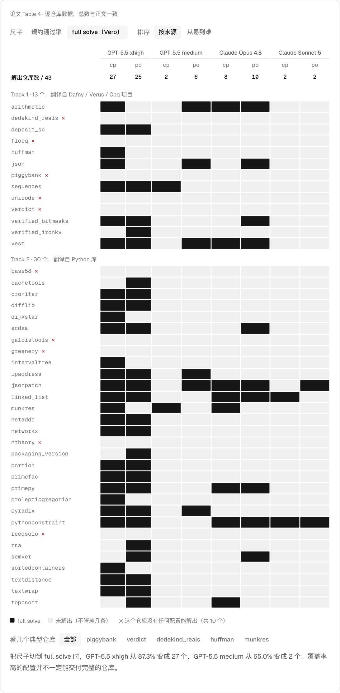

# Vero: Can AI Agents Build Formally Verified Software Repositories?

<p>
  <a href="./README.md"></a>
  <a href="./README.zh-CN.md"></a>
</p>

Ye et al. · 2026 · [arXiv:2608.13522](https://arxiv.org/abs/2608.13522) · [GitHub](https://github.com/sunblaze-ucb/vero)

之前的验证代码生成 benchmark 要么只考单个函数，要么实现已给定、只需补证明。Vero 要求 agent 在整个仓库上同时写实现和证明。



## 摘要（译文）

> AI agent 越来越多地用于编程，但它们不保证生成代码的正确性。在验证代码生成中，agent 既产出实现，也产出对规约的机器检查证明，这为可信的 AI 生成软件提供了一条更可靠的路径。这个方向现有的 benchmark，要么只关注单个函数，要么只在给定实现上评测证明生成。agent 能否在真实的多模块代码库中做出协调一致的实现和证明选择，仍是一个未解的问题。为填补这一空白，我们提出 Vero，第一个在仓库层面评测实现与证明联合合成的 benchmark。Vero 包含 43 个多模块实例，来源于 Python、Dafny、Verus 和 Coq 的真实仓库，覆盖从密码协议到分布式系统的多个领域。每个实例都是一个多模块 Lean 4 仓库，带有预先确定的 API 接口、人工整理的形式化规约和参考实现，同时支持 proof-only 和 code-and-proof 两种评测模式。为提高 benchmark 的可靠性，Vero 还包含审计机制：agent 可以形式化地证明给定规约不可满足，或参考代码不正确，从而在整理阶段发现并修正潜在的代码和规约错误。我们评测了可使用 Lean 工具链的前沿 coding agent 配置。最强的 agent 也只完全解出 43 个实例中的 27 个，在最难的仓库上一条规约也没有证出。Vero 为衡量仓库级验证软件合成的进展提供了具体的测试平台，而目前的 agent 在这一任务上仍有不足。我们在 https://github.com/sunblaze-ucb/vero 发布了 benchmark、整理流水线和评测框架。

## 改了什么

| | 之前 | 之后 |
|---|---|---|
| **考什么** | 单个函数，或实现给定、只补证明 | 43 个多模块 Lean 4 仓库，743 个 API，2,705 条规约，实现和证明一起写 |
| **怎么算解出** | 覆盖率：最强配置 87.3% | full solve：最强配置 27/43，10 个仓库没有任何配置能解出 |
| **作弊** | Lean 接受 `sorry` 和用户声明的公理，能编译不等于证明了 | 三层判分：标记区、公理白名单、声明筛查 |
| **实现** | 固定输入 | 可以改：能换成好证明的算法，也可能写坏拿 0 分 |
| **规约出错** | 算作 agent 失败 | agent 可以提交机器检查的反证，发现并修复了 38 处缺陷 |

## 论文原话（译文）

**考什么（第 3.2 节）**

> 现有的仓库级 benchmark 固定实现，孤立地评测证明生成，忽略了真实验证工作中实现选择与证明选择的相互影响。

**怎么算解出（第 4.1 节）**

> 我们采用 full solve 而不是部分规约覆盖率，因为部分覆盖率可能被简单的规约抬高；而且在 code-and-proof 模式下，一条未证明的规约可能不只意味着缺一个证明，还可能意味着实现违反了它，所以只有完全覆盖才能确认 agent 的代码是正确的。

**作弊（第 3.2 节）**

> 为确保 benchmark 评测的是真正的验证工作，判分器既阻止修改 benchmark 内容，也阻止让证明失去意义的手段。

**实现（第 4.2 节）**

> 每一次替换在行为上都是正确的，并不是走捷径，所以 agent 得到的是可证性，放弃的是效率。

**规约出错（第 3.5 节）**

> 把这些静默的失败算作 agent 的错误，会把 benchmark 的缺陷和 agent 的能力混为一谈。

## Demo 内容

| 小节 | 能做什么 | 数据来源 |
|---|---|---|
| 考什么 | 切换三种考法，看 agent 能动哪几行 | Figure 2；单函数例子是**示意** |
| 怎么算解出 | 在覆盖率和 full solve 之间切换 43 × 8 热力图 | Table 4 |
| 防作弊 | 把 8 种提交送进判分器 | Appendix D、G；前两份是**示意** |
| 实现的地位 | 跑枚举算法，对比两种模式 | Appendix G；由 Table 4 计算 |
| 题目出错 | 看 `verdict` 的两条规约在哪个字节冲突 | Appendix F、Table 6 |

## 数据

`data.ts` 是从论文 HTML 解析出来的 Table 4。解析时核对过正文里的总数：2,705 条规约，每种配置的通过数（2362、2320、1759、1629、1610、1970、1270、1237），full solve 数（27、25、2、6、8、10、2、2），以及 10 个没有任何配置能解出的仓库。

## 运行

在仓库根目录运行：

```bash
npm install
npm run dev
```

然后打开 <http://localhost:5173/agent/01-vero/>。如果端口被占用，请使用终端里显示的地址。

## 文件

| 文件 | 作用 |
|---|---|
| `data.ts` | Table 4 |
| `demo-*.ts` | 每个小节一个文件 |
| `paper.json` | 首页显示的信息 |

## 引用

```bibtex
@misc{ye2026vero,
  title         = {Vero: Can AI Agents Build Formally Verified Software Repositories?},
  author        = {Ye, Zhe and Lou, Hantao and Sun, Yuechun and Song, Peiyang and Yan, Zhengxu and Kasriel, Timothe and Zhang, Qingyang and Yang, Kaiyu and Kong, Soonho and He, Jingxuan and Song, Dawn},
  year          = {2026},
  eprint        = {2608.13522},
  archivePrefix = {arXiv},
  primaryClass  = {cs.LG}
}
```
