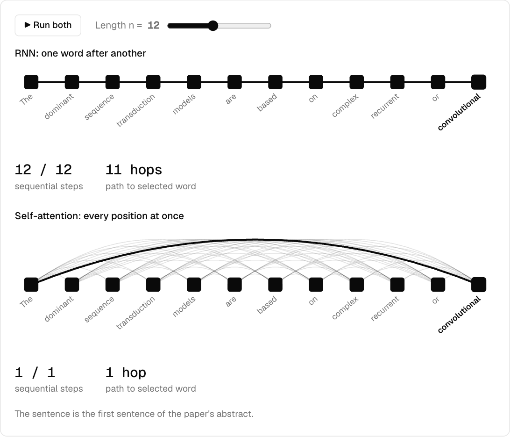

# Attention Is All You Need

<p>
  <a href="./README.md"></a>
  <a href="./README.zh-CN.md"></a>
</p>

Vaswani et al. · NeurIPS 2017 · [arXiv:1706.03762](https://arxiv.org/abs/1706.03762)

Translation models used to pass information step by step through RNNs or CNNs, with attention as a helper. This paper removes recurrence and convolution, leaving only attention.



## Abstract

> The dominant sequence transduction models are based on complex recurrent or convolutional neural networks that include an encoder and a decoder. The best performing models also connect the encoder and decoder through an attention mechanism. We propose a new simple network architecture, the Transformer, based solely on attention mechanisms, dispensing with recurrence and convolutions entirely. Experiments on two machine translation tasks show these models to be superior in quality while being more parallelizable and requiring significantly less time to train. Our model achieves 28.4 BLEU on the WMT 2014 English-to-German translation task, improving over the existing best results, including ensembles, by over 2 BLEU. On the WMT 2014 English-to-French translation task, our model establishes a new single-model state-of-the-art BLEU score of 41.8 after training for 3.5 days on eight GPUs, a small fraction of the training costs of the best models from the literature. We show that the Transformer generalizes well to other tasks by applying it successfully to English constituency parsing both with large and limited training data.

## What changed

| | Before | After |
|---|---|---|
| **Information flow** | Recurrent layers: O(n) sequential steps, O(n) maximum path | Self-attention: O(1) sequential steps, O(1) maximum path |
| **Role of attention** | Used alongside a recurrent network | The whole model, with 8 heads in parallel |
| **Scoring** | Dot product, which saturates softmax at high dimensions | Divide by √d_k |
| **Word order** | Implicit in the structure | Added back with sin/cos positional encoding |
| **English to German** | Best previous score: 26.36 BLEU | 28.4 BLEU at lower training cost |

## In the paper's words

**Information flow (Section 4)**

> a self-attention layer connects all positions with a constant number of sequentially executed operations, whereas a recurrent layer requires O(n) sequential operations.

**Multi-head attention (Section 3.2.2)**

> Multi-head attention allows the model to jointly attend to information from different representation subspaces at different positions. With a single attention head, averaging inhibits this.

**Scaling (Section 3.2.1)**

> We suspect that for large values of d_k, the dot products grow large in magnitude, pushing the softmax function into regions where it has extremely small gradients.

**Position (Section 3.5)**

> Since our model contains no recurrence and no convolution, in order for the model to make use of the order of the sequence, we must inject some information about the relative or absolute position of the tokens in the sequence.

## The demo

| Section | What you can do | Data source |
|---|---|---|
| Information flow | Run an RNN and self-attention side by side, click words to see paths, compare complexity | Table 1 |
| Multi-head | Switch heads, change the last word, turn on the decoder mask | **Toy vectors** set by hand; the formula is real |
| Scaling | Drag d_k, compare softmax with and without scaling, measure the variance | Live simulation under the paper's footnote assumption |
| Position | Reorder words and toggle positional encoding | Random embeddings with real computation; encoding formula from the paper |
| Results | Compare BLEU against training cost | Table 2 (EN-DE) |

## Run it

From the repository root:

```bash
npm install
npm run dev
```

Then open <http://localhost:5173/llm/01-attention-is-all-you-need/>. If that port is taken, use the address shown in the terminal.

## Files

| File | Purpose |
|---|---|
| `math.ts` | The paper's formulas: softmax, scaled dot-product and positional encoding |
| `demo-*.ts` | One file per section |
| `paper.json` | Details shown on the home page |

## Citation

```bibtex
@inproceedings{vaswani2017attention,
  title     = {Attention Is All You Need},
  author    = {Vaswani, Ashish and Shazeer, Noam and Parmar, Niki and Uszkoreit, Jakob and Jones, Llion and Gomez, Aidan N. and Kaiser, {\L}ukasz and Polosukhin, Illia},
  booktitle = {Advances in Neural Information Processing Systems},
  volume    = {30},
  year      = {2017}
}
```
