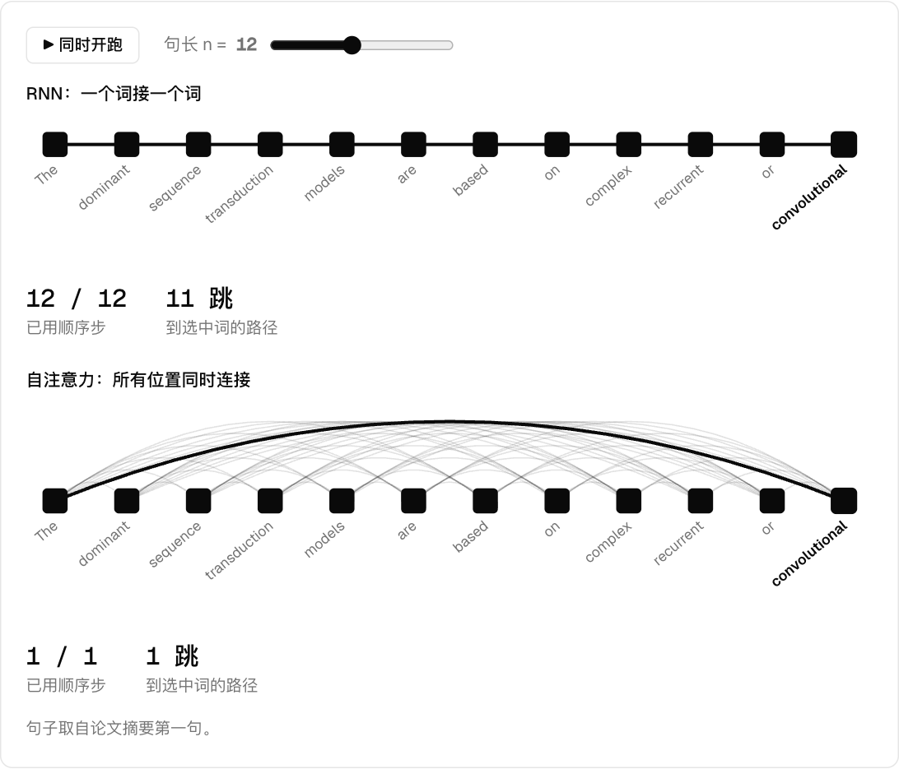

# Attention Is All You Need

<p>
  <a href="./README.md"></a>
  <a href="./README.zh-CN.md"></a>
</p>

Vaswani et al. · NeurIPS 2017 · [arXiv:1706.03762](https://arxiv.org/abs/1706.03762)

之前的翻译模型靠 RNN 或 CNN 逐步传递信息，注意力只是辅助。这篇论文去掉循环和卷积，只留下注意力。



## 摘要（译文）

> 目前主流的序列转换模型都基于复杂的循环或卷积神经网络，包含一个编码器和一个解码器。表现最好的模型还通过注意力机制把编码器和解码器连接起来。我们提出一种新的简单网络架构 Transformer，它完全基于注意力机制，彻底摒弃了循环和卷积。在两个机器翻译任务上的实验表明，这类模型质量更高，同时更易并行，训练时间也大幅减少。我们的模型在 WMT 2014 英译德任务上达到 28.4 BLEU，比现有最好结果（包括 ensemble）高出 2 BLEU 以上。在 WMT 2014 英译法任务上，模型在 8 块 GPU 上训练 3.5 天后，创下 41.8 BLEU 的单模型新纪录，训练成本只是文献中最好模型的一小部分。我们还把 Transformer 成功用于英语成分句法分析，无论训练数据多还是少都表现良好，说明它能很好地推广到其他任务。

## 改了什么

| | 之前 | 之后 |
|---|---|---|
| **信息流动** | 循环层：O(n) 个顺序步，最长路径 O(n) | 自注意力：O(1) 个顺序步，最长路径 O(1) |
| **注意力的角色** | 配合循环网络使用 | 模型的全部，8 个头并行 |
| **打分** | 点积，维度高时 softmax 饱和 | 除以 √d_k |
| **词序** | 隐含在结构里 | 用 sin/cos 位置编码加回去 |
| **英译德** | 此前最好 26.36 BLEU | 28.4 BLEU，训练成本更低 |

## 论文原话（译文）

**信息流动（第 4 节）**

> 自注意力层用常数个顺序执行的操作连接所有位置，而循环层需要 O(n) 个顺序操作。

**多头注意力（第 3.2.2 节）**

> 多头注意力让模型能够同时关注不同表示子空间、不同位置上的信息。只用单个注意力头时，平均操作会抑制这一点。

**缩放（第 3.2.1 节）**

> 我们猜测，当 d_k 很大时，点积的数值会变得很大，把 softmax 函数推入梯度极小的区域。

**位置（第 3.5 节）**

> 由于模型既没有循环也没有卷积，为了让模型利用序列的顺序，我们必须注入一些关于词元相对或绝对位置的信息。

## Demo 内容

| 小节 | 能做什么 | 数据来源 |
|---|---|---|
| 信息流动 | RNN 和自注意力同时开跑，点词看路径，比较复杂度 | Table 1 |
| 多头 | 切换头、换句尾的词、打开解码器掩码 | **玩具向量**，手工设定；公式是真的 |
| 缩放 | 拖动 d_k，对比缩放前后的 softmax，实测方差 | 按论文脚注的假设实时模拟 |
| 位置编码 | 换语序，开关位置编码 | 随机词向量 + 真实运算；编码公式来自论文 |
| 结果 | 对比 BLEU 和训练成本 | Table 2（EN-DE） |

## 运行

在仓库根目录运行：

```bash
npm install
npm run dev
```

然后打开 <http://localhost:5173/llm/01-attention-is-all-you-need/>。如果端口被占用，请使用终端里显示的地址。

## 文件

| 文件 | 作用 |
|---|---|
| `math.ts` | 论文公式：softmax、缩放点积、位置编码 |
| `demo-*.ts` | 每个小节一个文件 |
| `paper.json` | 首页显示的信息 |

## 引用

```bibtex
@inproceedings{vaswani2017attention,
  title     = {Attention Is All You Need},
  author    = {Vaswani, Ashish and Shazeer, Noam and Parmar, Niki and Uszkoreit, Jakob and Jones, Llion and Gomez, Aidan N. and Kaiser, {\L}ukasz and Polosukhin, Illia},
  booktitle = {Advances in Neural Information Processing Systems},
  volume    = {30},
  year      = {2017}
}
```
